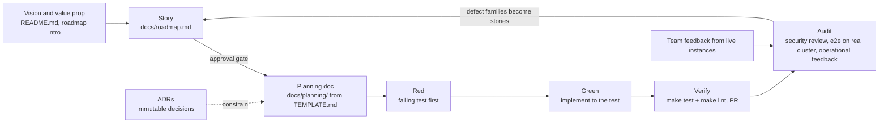

# The Method — story → plan → red → green → verify → audit

How this repo is built. This is Stakater's house method (first codified in
kube-ward, adapted here): a customized take on spec-driven development — see
[Relationship to BMAD](#relationship-to-bmad). Every practice below names where
it is enforced **in this repo today**; where enforcement isn't wired yet, the
table says so honestly and the gap is a roadmap story, not a pretense.

## The loop

Two loops: the **inner build loop** (story → plan → red → green → verify) ships
one story end-to-end; the **outer evidence loop** (audit → fix stories →
re-audit) measures whether shipping made the product better. For an operator
that runs other teams' identity provider, the outer loop is security reviews,
e2e runs against real clusters, and feedback from the teams running instances —
quality claims are grounded in those, not assumed from green CI.

## The practices, and where each is enforced here

| Practice | Lineage | What it looks like here | Enforced by |
|---|---|---|---|
| Spec first | Spec-driven development | vision → story → planning doc **before code**, in order | workflow rule in CLAUDE.md; planning doc committed before implementation |
| Immutable decisions | ADRs (Nygard) | `docs/adr/` — accepted ADRs are never edited, only superseded | ADR convention in CLAUDE.md; review |
| Story-driven delivery | user stories / agile | house format + **Done:** line + lifecycle (below), one story at a time | roadmap convention; PR descriptions cite the story |
| Test-first | TDD (Beck) | red → green → refactor; envtest for controllers, table-driven units for pure logic | review today; a `make verify` + edit-hook (as in kube-ward) is a Draft DX story — until then this relies on discipline |
| Domain modeling | DDD (Evans) | builders own resources, reconcilers orchestrate; CRD types are the domain language | repo-map split in CLAUDE.md; review |
| Production evaluation | eval-driven development | security findings and operational incidents from live team instances become labeled issues → stories → fixes | GitHub issues with `security`/`severity/*` labels; roadmap SEC epic |
| Adversarial review | multi-agent verification | `/code-review` on non-trivial PRs: independent finder angles → cross-verified findings | the review flow |
| Context persistence | (substitute for fresh-agent handoffs) | CLAUDE.md invariants + context-capsule planning docs | TEMPLATE.md |

## Story lifecycle

**📝 Draft** — written down so it isn't lost; explicitly *not* agreed. May be
re-scoped or killed; killing a weak Draft is a success of the method, not a
failure. → **👍 Approved** — a human said build it. The gate exists because
comply-by-default is the failure mode: an unapproved story must never start.
→ **🔨 In progress** — one at a time, end-to-end. → **✅ Done** — the Done
line met, tests and lint green, planning doc linked from the story.

## The planning doc is a context capsule

`docs/planning/TEMPLATE.md` is the contract: a planning doc must carry enough
context that a **cold session** — no memory, no conversation history — can
execute the story without re-scouting the codebase. That means: the story and
its why, the governing ADRs/invariants, the exact seams and files, the test
list (which tests, at which seams, red first), and the explicit out-of-scope.
If a planning doc needs the author present to be actionable, it isn't done.

## Relationship to BMAD

Evaluated against BMAD v6 (the spec-driven multi-agent framework). The substance
overlaps heavily — BMAD's brief/PRD ↔ our vision docs, its Architect phase ↔ our
ADRs, its story files ↔ our story+planning pairs, its QA gate ↔ our DoD +
multi-angle review. We deliberately **borrowed** two things it does with more
rigor: the context-capsule story discipline (→ TEMPLATE.md) and the explicit
lifecycle gate (→ Draft/Approved). We deliberately **kept our own** where we
differ: persistent memory instead of persona handoffs (one agent, human gates,
multi-agent only where fan-out pays — review and audits), immutable ADRs
(BMAD's architecture doc is mutable), and the outer audit loop, which BMAD has
no equivalent of and which we consider the load-bearing quality mechanism.

## Invariants of the method itself

1. **No code without a red test that demanded it.**
2. **No implementation without a committed plan; no plan without a story; no
   story built without approval.**
3. **Honesty over completeness** — "couldn't verify / not assessed" beats a
   confident guess, in status conditions and in our own reports alike.
4. **Docs are the source of truth and move with the code** — a semantic change
   that leaves `docs/` stale is an unfinished change.
5. **The audit loop closes.** Security findings and live-instance incidents are
   filed as labeled issues, become stories, and the fix is checked against the
   original finding — not just against its own tests.
